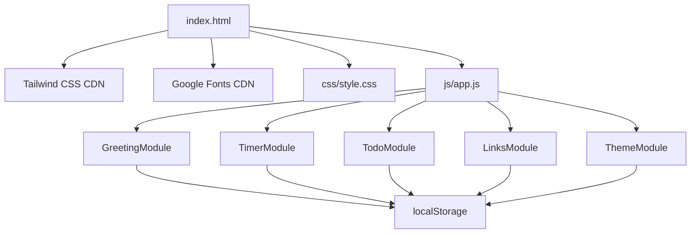

# Design Document

## Overview

To-Do List Life Dashboard adalah sebuah single-page application (SPA) berbasis web yang dibangun dengan HTML, Tailwind CSS (via CDN), dan Vanilla JavaScript murni. Tidak ada server-side logic, tidak ada build tools, dan tidak ada dependency yang perlu diinstal — semua berjalan di browser pengguna.

**Prinsip arsitektur utama:**

- **Client-only** — semua logika berjalan di browser. Data tersimpan di `localStorage`.
- **Module per komponen** — setiap fitur utama (Greeting, Timer, Todo, Links, Theme) dikemas dalam satu objek atau namespace JavaScript yang berdiri sendiri di dalam satu file `app.js`.
- **DOM sebagai sumber kebenaran tampilan** — state disimpan di memori JS, dirender ke DOM, dan dipertahankan ke `localStorage`. Tidak ada framework reaktif; pembaruan DOM dilakukan secara manual setiap kali state berubah.
- **Mobile-first** — layout dimulai dari lebar 320px dan diperluas menggunakan Tailwind breakpoint `md:` dan `lg:`.

**Alur data secara umum:**

```
User Interaction
      ↓
Event Handler (di app.js)
      ↓
Update State (objek JS di memori)
      ↓
Persist ke localStorage
      ↓
Re-render DOM
```

---

## Architecture

### Struktur File

```
project-root/
├── index.html          ← markup semua komponen
├── css/
│   └── style.css       ← custom variables, animasi, override Tailwind
├── js/
│   └── app.js          ← semua logika JavaScript
└── README.md
```

### Diagram Arsitektur Tinggi



### CDN yang Digunakan

| Resource | URL |
|---|---|
| Tailwind CSS Play CDN | `https://cdn.tailwindcss.com` |
| Google Fonts: Lato | `https://fonts.googleapis.com/css2?family=Lato:wght@400;700&display=swap` |
| Google Fonts: Luckiest Guy | `https://fonts.googleapis.com/css2?family=Luckiest+Guy&display=swap` |

---

## Components and Interfaces

### Layout Halaman (index.html)

Halaman dibagi menjadi tiga bagian utama:

```
┌─────────────────────────────────┐
│         HEADER / NAVBAR         │  ← tombol theme switch
├─────────────────────────────────┤
│         GREETING SECTION        │  ← waktu, tanggal, salam, nama
├──────────────┬──────────────────┤
│ FOCUS TIMER  │   TO-DO LIST     │  ← (desktop: 2 kolom)
├──────────────┴──────────────────┤
│          QUICK LINKS            │  ← pintasan URL
└─────────────────────────────────┘
```

**Mobile** (< 768px): semua komponen ditumpuk satu kolom secara vertikal.  
**Tablet** (768px–1023px): Greeting penuh lebar, lalu Timer + Todo berdampingan, Links di bawah.  
**Desktop** (≥ 1024px): layout grid 2–3 kolom.

### Komponen: Greeting Section

**Elemen HTML:**
- `#greeting-text` — teks salam dinamis ("Selamat Pagi, Ahmad!")
- `#clock-display` — jam real-time (HH:MM:SS)
- `#date-display` — tanggal lengkap Bahasa Indonesia
- `#name-input` — input teks nama pengguna (maxlength="50")
- `#name-save-btn` — tombol simpan nama
- `#clock-error` — pesan error jika pembaruan waktu berhenti (tersembunyi secara default)

**Interface JS (GreetingModule):**
```
GreetingModule
  ├── init()                    ← dipanggil saat halaman dimuat
  ├── startClock()              ← memulai setInterval 1 detik
  ├── updateDisplay(date)       ← memperbarui clock, date, greeting
  ├── getGreeting(hour)         ← mengembalikan string salam berdasarkan jam
  ├── formatTime(date)          ← "HH:MM:SS"
  ├── formatDate(date)          ← "Senin, 20 November 2026"
  ├── saveName(name)            ← simpan ke localStorage
  ├── loadName()                ← baca dari localStorage
  └── renderGreeting()          ← gabungkan salam + nama → DOM
```

### Komponen: Focus Timer

**Elemen HTML:**
- `#timer-display` — tampilan MM:SS (font Luckiest Guy)
- `#timer-start-btn` — tombol Start
- `#timer-stop-btn` — tombol Stop
- `#timer-reset-btn` — tombol Reset
- `#timer-duration-input` — input angka durasi (min=1, max=120)
- `#timer-save-duration-btn` — tombol simpan durasi
- `#timer-duration-error` — pesan error validasi durasi
- `#timer-complete-notification` — notifikasi sesi selesai (tersembunyi secara default)

**Interface JS (TimerModule):**
```
TimerModule
  ├── init()
  ├── start()                   ← mulai countdown via setInterval
  ├── stop()                    ← clearInterval, pertahankan sisa waktu
  ├── reset()                   ← clearInterval, kembalikan ke durasi aktif
  ├── tick()                    ← dipanggil setiap detik, kurangi remainingSeconds
  ├── updateDisplay()           ← render MM:SS ke DOM
  ├── onComplete()              ← tampilkan notifikasi saat 00:00
  ├── saveDuration(minutes)     ← validasi & simpan ke localStorage
  ├── loadDuration()            ← baca dari localStorage
  ├── setButtonState(isRunning) ← enable/disable tombol Start
  └── formatMMSS(seconds)       ← "MM:SS"
```

### Komponen: To-Do List

**Elemen HTML:**
- `#todo-input` — input teks tugas (maxlength="200")
- `#todo-add-btn` — tombol tambah
- `#todo-list` — container `<ul>` daftar Task
- `#todo-empty-warning` — pesan peringatan input kosong

Setiap Task dirender sebagai `<li>` yang berisi:
- Tombol centang (`[data-action="toggle"]`)
- Teks tugas (dengan class `line-through` jika selesai)
- Tombol edit (`[data-action="edit"]`)
- Tombol hapus (`[data-action="delete"]`)

**Interface JS (TodoModule):**
```
TodoModule
  ├── init()
  ├── addTask(text)             ← validasi → buat objek Task → simpan → render
  ├── editTask(id, newText)     ← validasi → update state → simpan → render
  ├── toggleTask(id)            ← flip status done → simpan → render
  ├── deleteTask(id)            ← hapus dari array → simpan → render
  ├── renderAll()               ← render ulang seluruh daftar dari state
  ├── renderTask(task)          ← buat elemen <li> satu Task
  ├── saveTasks()               ← JSON.stringify ke localStorage
  └── loadTasks()               ← JSON.parse dari localStorage
```

### Komponen: Quick Links

**Elemen HTML:**
- `#link-name-input` — input nama link (maxlength="50")
- `#link-url-input` — input URL (maxlength="2000")
- `#link-add-btn` — tombol tambah
- `#link-list` — container grid pintasan
- `#link-warning` — pesan peringatan input kosong/invalid

Setiap Link dirender sebagai kartu yang berisi:
- Ikon/nama link (sebagai anchor `<a target="_blank">`)
- Tombol hapus

**Interface JS (LinksModule):**
```
LinksModule
  ├── init()
  ├── addLink(name, url)        ← validasi → normalize URL → simpan → render
  ├── deleteLink(id)            ← hapus dari array → simpan → render
  ├── normalizeUrl(url)         ← tambah "https://" jika tidak ada prefix
  ├── renderAll()
  ├── renderLink(link)
  ├── saveLinks()
  └── loadLinks()
```

### Komponen: Theme Manager

**Elemen HTML:**
- `#theme-toggle-btn` — tombol switch Light/Dark mode (min 44×44px)

**Interface JS (ThemeModule):**
```
ThemeModule
  ├── init()
  ├── toggle()                  ← ganti tema → simpan → apply
  ├── apply(theme)              ← tambah/hapus class pada <html> element
  ├── saveTheme(theme)
  └── loadTheme()               ← default: "light"
```

---

## Data Models

Semua data disimpan di `localStorage` browser. Tidak ada server atau database.

### Kunci-kunci localStorage

| Key | Tipe | Deskripsi |
|---|---|---|
| `tl_username` | `string` | Nama pengguna untuk salam |
| `tl_timer_duration` | `number` | Durasi Pomodoro dalam menit (1–120) |
| `tl_tasks` | `string` (JSON array) | Daftar semua Task |
| `tl_links` | `string` (JSON array) | Daftar semua Quick Link |
| `tl_theme` | `string` | Preferensi tema: `"light"` atau `"dark"` |

### Model: Task

```js
{
  id: string,       // ID unik, dibuat via Date.now().toString()
  text: string,     // deskripsi tugas, 1–200 karakter
  done: boolean,    // false = belum selesai, true = selesai
  createdAt: number // timestamp saat task dibuat (Date.now())
}
```

**Contoh:**
```json
[
  { "id": "1700000001000", "text": "Belajar JavaScript", "done": false, "createdAt": 1700000001000 },
  { "id": "1700000002000", "text": "Olahraga pagi",      "done": true,  "createdAt": 1700000002000 }
]
```

### Model: Link

```js
{
  id: string,   // ID unik, Date.now().toString()
  name: string, // label tampilan, 1–50 karakter
  url: string   // URL lengkap (selalu diawali "http://" atau "https://"), 1–2000 karakter
}
```

**Contoh:**
```json
[
  { "id": "1700000003000", "name": "GitHub",  "url": "https://github.com" },
  { "id": "1700000004000", "name": "YouTube", "url": "https://youtube.com" }
]
```

### Model: Tema

Disimpan sebagai string sederhana:
```
"light" | "dark"
```

### Model: Durasi Timer

Disimpan sebagai angka integer (menit):
```
25   ← default
```

---

## Correctness Properties

*A property is a characteristic or behavior that should hold true across all valid executions of a system — essentially, a formal statement about what the system should do. Properties serve as the bridge between human-readable specifications and machine-verifiable correctness guarantees.*

### Property 1: Pemetaan salam berdasarkan jam

*Untuk setiap* nilai jam valid (0–23), fungsi `getGreeting(hour)` harus mengembalikan tepat satu dari empat string salam yang telah ditentukan, dan setiap jam harus dipetakan ke satu string yang konsisten.

**Validates: Requirements 2.1, 2.2, 2.3, 2.4**

### Property 2: Nama pengguna disimpan dan dibaca kembali dengan benar (round-trip)

*Untuk setiap* string nama yang valid (1–50 karakter, bukan hanya spasi), memanggil `saveName(name)` lalu `loadName()` harus mengembalikan string yang sama persis.

**Validates: Requirements 3.3, 3.4**

### Property 3: Task list round-trip ke localStorage

*Untuk setiap* array Task yang valid, memanggil `saveTasks(tasks)` lalu `loadTasks()` harus menghasilkan array yang secara struktural identik dengan array asal (sama panjang, sama `id`, `text`, `done`, `createdAt` untuk setiap elemen).

**Validates: Requirements 6.11, 6.12**

### Property 4: Menambah task selalu menambah panjang daftar

*Untuk setiap* daftar Task yang ada dan setiap teks task yang valid (tidak kosong, tidak hanya spasi, panjang ≤ 200 karakter), memanggil `addTask(text)` harus menghasilkan daftar Task dengan panjang bertambah tepat satu.

**Validates: Requirements 6.2**

### Property 5: Input task tidak valid tidak mengubah daftar

*Untuk setiap* daftar Task dan setiap string yang terdiri dari hanya spasi (atau kosong), memanggil `addTask(text)` tidak boleh mengubah panjang atau isi daftar Task.

**Validates: Requirements 6.3**

### Property 6: Normalisasi URL menambahkan prefix jika diperlukan

*Untuk setiap* string URL, `normalizeUrl(url)` harus menghasilkan URL yang selalu diawali dengan `"http://"` atau `"https://"`. Jika URL sudah memiliki prefix tersebut, hasilnya harus identik dengan input.

**Validates: Requirements 7.4**

### Property 7: Quick Links round-trip ke localStorage

*Untuk setiap* array Link yang valid, memanggil `saveLinks(links)` lalu `loadLinks()` harus menghasilkan array yang secara struktural identik dengan array asal.

**Validates: Requirements 7.7, 7.8**

### Property 8: Validasi durasi timer menerima nilai dalam rentang dan menolak di luar rentang

*Untuk setiap* integer `d`, fungsi validasi durasi harus menerima `d` jika dan hanya jika `1 ≤ d ≤ 120`. Semua nilai di luar rentang harus ditolak tanpa mengubah durasi aktif.

**Validates: Requirements 5.1, 5.4**

### Property 9: Durasi timer round-trip ke localStorage

*Untuk setiap* nilai durasi yang valid (integer 1–120), memanggil `saveDuration(d)` lalu `loadDuration()` harus mengembalikan nilai integer yang sama.

**Validates: Requirements 5.5, 5.6**

---

## Error Handling

### Kegagalan localStorage

`localStorage` dapat gagal dalam dua kondisi: browser dalam private mode dengan kuota penuh, atau pengguna menonaktifkan web storage. Setiap operasi baca/tulis localStorage dibungkus dalam blok `try/catch`:

```js
function safeGet(key, fallback) {
  try {
    const val = localStorage.getItem(key);
    return val !== null ? val : fallback;
  } catch {
    return fallback;
  }
}

function safeSet(key, value) {
  try {
    localStorage.setItem(key, value);
  } catch {
    console.warn('localStorage tidak tersedia. Data tidak disimpan.');
  }
}
```

Jika `localStorage` gagal dibaca, setiap modul menggunakan nilai default (nama kosong, durasi 25 menit, tasks kosong, links kosong, tema light).

### Pembaruan Waktu Berhenti

`GreetingModule.startClock()` menyimpan timestamp terakhir pembaruan. Sebuah watchdog interval terpisah (interval 3 detik) memeriksa apakah clock telah diperbarui dalam 2 detik terakhir. Jika tidak, elemen `#clock-error` ditampilkan.

### Input Tidak Valid

Validasi dilakukan di lapisan JS sebelum menyentuh state atau localStorage:

| Kondisi | Perilaku |
|---|---|
| Nama kosong/spasi saja | Simpan sebagai string kosong, salam tanpa nama |
| Nama > 50 karakter | Dicegah oleh `maxlength="50"` pada input HTML |
| Task kosong/spasi | Tampilkan `#todo-empty-warning`, tidak tambah task |
| Task > 200 karakter | Dicegah oleh `maxlength="200"` |
| Durasi < 1 atau > 120 | Tampilkan `#timer-duration-error`, pertahankan durasi sebelumnya |
| URL kosong/spasi | Tampilkan `#link-warning`, tidak tambah link |
| URL tanpa prefix | `normalizeUrl()` menambahkan `"https://"` otomatis |

### JSON Parse Error

Saat membaca tasks atau links dari localStorage, data di-parse dengan `JSON.parse`. Jika data korup (tidak valid JSON), `catch` akan mengembalikan array kosong `[]` agar aplikasi tetap berjalan.

```js
function loadTasks() {
  try {
    return JSON.parse(safeGet('tl_tasks', '[]')) || [];
  } catch {
    return [];
  }
}
```

---

## Testing Strategy

### Pendekatan Pengujian

Pengujian dibagi menjadi dua lapisan yang saling melengkapi:

1. **Unit Tests** — Menguji fungsi-fungsi murni secara terisolasi dengan contoh spesifik dan edge case.
2. **Property-Based Tests** — Menguji properti universal yang harus berlaku untuk semua input valid menggunakan library [fast-check](https://github.com/dubzzz/fast-check).

### Unit Tests

Fokus pada skenario konkret dan kondisi batas:

| Fungsi | Skenario yang Diuji |
|---|---|
| `getGreeting(hour)` | Jam 0, 5, 11, 12, 14, 15, 17, 18, 23 (nilai batas setiap periode) |
| `formatTime(date)` | Pastikan padding dua digit untuk jam/menit/detik |
| `formatDate(date)` | Output Bahasa Indonesia yang benar |
| `normalizeUrl(url)` | URL dengan `http://`, dengan `https://`, tanpa prefix, string kosong |
| `addTask(text)` | Teks normal, spasi saja, kosong, 200 karakter, 201 karakter |
| `toggleTask(id)` | Task yang belum selesai → selesai, task selesai → belum selesai |
| `loadTasks()` | localStorage kosong, data valid, data korup (JSON tidak valid) |

### Property-Based Tests

Menggunakan **fast-check** (JavaScript). Setiap property-based test harus dijalankan minimum **100 iterasi**.

Setiap test diberi tag komentar dalam format:
```
// Feature: todo-list-life-dashboard, Property N: <teks properti>
```

| Property | Strategi Generator |
|---|---|
| Property 1: Pemetaan salam | Generate integer arbitrary dari 0–23 |
| Property 2: Nama round-trip | Generate string panjang 1–50 (bukan hanya whitespace) |
| Property 3: Task list round-trip | Generate array objek Task dengan field yang valid |
| Property 4: Tambah task menambah panjang | Generate array Task + string non-kosong |
| Property 5: Input tidak valid tidak mengubah daftar | Generate string whitespace-only (spasi, tab, newline) |
| Property 6: Normalisasi URL | Generate string URL acak (dengan/tanpa prefix http/https) |
| Property 7: Links round-trip | Generate array objek Link dengan field yang valid |
| Property 8: Validasi durasi | Generate integer di dalam dan di luar rentang 1–120 |
| Property 9: Durasi round-trip | Generate integer dari 1–120 |

**Catatan tentang pengujian UI**: Komponen-komponen yang melibatkan rendering DOM (render task ke `<li>`, render link ke kartu, dsb.) diuji menggunakan **snapshot tests** atau **example-based unit tests**, bukan property-based tests, karena perilakunya tidak bervariasi secara bermakna berdasarkan input acak.

**Catatan tentang pengujian responsivitas**: Layout dan visual diperiksa secara manual atau menggunakan browser devtools resize, bukan automated tests.
